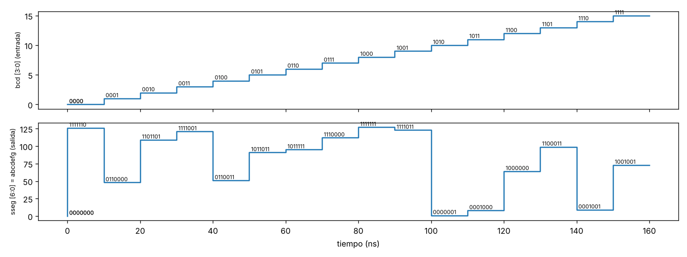

# Taller decodificador de 7 segmentos

## 1. Tabla de decodificación

Archivo: `tabla_7seg.txt` (16 líneas, 7 bits por línea, orden abcdefg).

Dígitos 0-9: patrones estándar.
- El 6 es cerrado (enciende el segmento a de arriba).
- El 9 es cerrado (enciende el segmento d de abajo).
- El 1 se dibuja a la derecha (segmentos b y c).

Entradas 10-15 (patrones propios, sin letras A-F):

| Entrada | abcdefg | Símbolo | Justificación |
|---|---|---|---|
| 10 | 0000001 | `-` | solo el segmento central g, como un guion |
| 11 | 0001000 | `_` | solo el segmento de abajo d, guion bajo |
| 12 | 1000000 | `¯` | solo el segmento de arriba a, raya superior |
| 13 | 1100011 | `°` | cuadrito de arriba (a, b, f, g), símbolo de grado |
| 14 | 0001001 | `=` | dos barras (d, g), signo igual |
| 15 | 1001001 | `≡` | tres barras (a, d, g), triple raya |

## 2. Comandos usados

```
pip install myhdl pytest
python3 sevensegdec.py --simulation --table tabla_7seg.txt     (simulación + VHDL)
python3 sevensegdec.py --verilog --table tabla_7seg.txt        (Verilog)
python3 -m pytest -v                                           (pruebas unitarias)
```

## 3. Resultados de la simulación

Salida de la simulación:

```
t=   0 ns  bcd= 0 (0000)  sseg(abcdefg)=1111110
t=  10 ns  bcd= 1 (0001)  sseg(abcdefg)=0110000
t=  20 ns  bcd= 2 (0010)  sseg(abcdefg)=1101101
t=  30 ns  bcd= 3 (0011)  sseg(abcdefg)=1111001
t=  40 ns  bcd= 4 (0100)  sseg(abcdefg)=0110011
t=  50 ns  bcd= 5 (0101)  sseg(abcdefg)=1011011
t=  60 ns  bcd= 6 (0110)  sseg(abcdefg)=1011111
t=  70 ns  bcd= 7 (0111)  sseg(abcdefg)=1110000
t=  80 ns  bcd= 8 (1000)  sseg(abcdefg)=1111111
t=  90 ns  bcd= 9 (1001)  sseg(abcdefg)=1111011
t= 100 ns  bcd=10 (1010)  sseg(abcdefg)=0000001
t= 110 ns  bcd=11 (1011)  sseg(abcdefg)=0001000
t= 120 ns  bcd=12 (1100)  sseg(abcdefg)=1000000
t= 130 ns  bcd=13 (1101)  sseg(abcdefg)=1100011
t= 140 ns  bcd=14 (1110)  sseg(abcdefg)=0001001
t= 150 ns  bcd=15 (1111)  sseg(abcdefg)=1001001
Simulation done. No errors.
```

El testbench recorre las 16 entradas (0 a 15), espera 10 ns a que la salida se estabilice y compara `sseg` con el valor de la tabla para esa entrada. No sale ningún mensaje de ERROR porque la salida coincide con la tabla en los 16 casos (el decodificador se construye con esa misma tabla). Los 7 bits de `sseg` son los segmentos a, b, c, d, e, f, g (el bit más alto es a y el más bajo es g); un 1 es segmento encendido.

VCD: `sevensegdec_tb.vcd`, abierto en vc.drom.io (captura en `forma_de_onda.png`). La entrada `bcd` sube de 0 a 15 cambiando cada 10 ns, y `sseg` cambia en el mismo instante, sin retardo, porque es lógica combinacional (no hay reloj). Cada valor de `sseg` coincide con la tabla.



Código HDL generado: [`sevensegdec_nexys.vhd`](sevensegdec_nexys.vhd) y [`sevensegdec_nexys.v`](sevensegdec_nexys.v).

La tabla (LUT) se convierte en un `case` sobre la entrada `bcd`: cada línea de la tabla es un `when` (VHDL) o un caso (Verilog) con el valor de 7 bits de salida. Un `case` sin memoria es una tabla de verdad, que la herramienta de síntesis convierte en lógica combinacional (una función booleana de 4 variables por cada segmento). Después hay un segundo proceso que invierte la salida si `invert` está activo.

## 4. Pruebas unitarias

Usé pytest. Modifiqué `sevensegdec.py` así: el testbench ya no verifica nada, solo aplica las 16 entradas y guarda los resultados; la verificación se hace en `test_sevensegdec.py`, separada de la lógica del decodificador. Las pruebas están parametrizadas con los 16 casos (`@pytest.mark.parametrize("bcd", range(16))`) y también prueban la salida invertida y que la tabla tenga 16 líneas de 7 bits. Resultado: `54 passed`.
